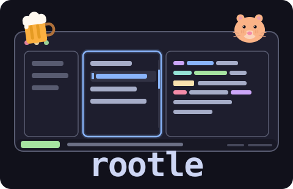

# rootledev/homebrew-tap

[](https://github.com/rootledev/homebrew-tap/actions/workflows/test.yml)
[](https://github.com/rootledev/homebrew-tap)



Homebrew tap for [rootle](https://rootle.dev/) — a modal TUI for
browsing remote source-control systems from the terminal.

```
brew install rootledev/tap/rootle
```

Active support is **Linux x86_64, including WSL x86_64**. ARM, macOS,
and native Windows are not supported. Run Homebrew inside the Linux
environment when using WSL.

The formula builds from the crates.io source crate and requires Linux
and an x86_64 CPU. Version + checksum bumps are automated by rootle's
release workflow. For the prebuilt `x86_64-unknown-linux-musl` binary,
use the installer at [rootle.dev](https://rootle.dev/).

The macOS cask has been retired from the active tap; existing Git history
and published release assets are preserved, not a current support promise.

CI is configured to run `brew style`, `brew audit --new`, a full
build-from-source install, and `brew test` on Linux x86_64 for every
change (and weekly). The badge links to actual results; this policy
change does not itself establish a passing run. There is no official
"verified tap" program.
